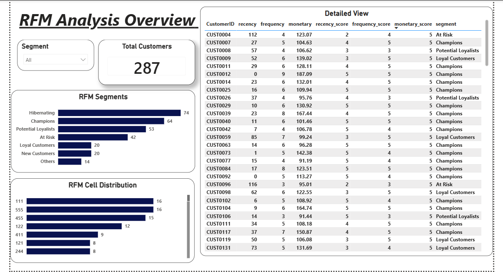
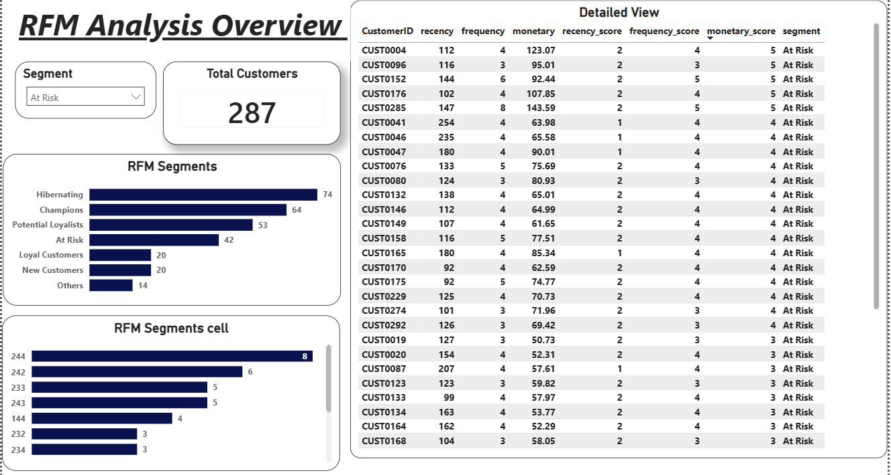

# 👥 Customer Behavioral Segmentation & RFM Value Optimization

An end-to-end customer intelligence solution that cleans, aggregates, and scores 12 months of transactional sales data using T-SQL quintiles (`NTILE`), classifying 287 customer accounts into behavioral cohorts to prevent churn and maximize Customer Lifetime Value (LTV).

---

## 1. Project Title & Overview

### Business Problem
Treating all customer accounts identically in marketing and sales outreach resulted in diminishing promotional conversion rates, unbudgeted discounting, and undetected customer churn. Specifically:
1. **Generic Marketing Campaigns:** High-value customers received mass-market promotional emails, diluting brand prestige without driving incremental orders.
2. **Hidden Churn Among Lucrative Accounts:** Accounts with high historical spend drifted into inactivity without warning, leaving account managers unaware until accounts fully defected to competitors.
3. **Inefficient Budget Allocation:** Marketing resources were disproportionately spent chasing long-dormant leads rather than nurturing active accounts with high upside potential.

### Solution & Scope
To solve this, a complete data pipeline and business intelligence reporting suite was developed:
- **Data Engineering & Consolidation:** Engineered a 5-stage **T-SQL pipeline** that consolidates 12 monthly transactional partitions (2025-01 through 2025-12), computes customer-level Recency, Frequency, and Monetary metrics, and assigns statistical quintile scores (1–5) via window functions (`NTILE(5)`).
- **Behavioral Segmentation Framework:** Categorized **287 customer accounts** into 7 distinct business cohorts (*Champions, Potential Loyalists, At Risk, Loyal Customers, New Customers, Hibernating, and Others*).
- **Interactive Executive Reporting:** Built an intuitive **Microsoft Power BI** dashboard featuring dynamic cross-filtering by segment, RFM cell distribution analysis, and account-level drill-through capabilities.

---

## 2. Tech Stack

| Technology | Role in Project |
| :--- | :--- |
| **Microsoft Power BI Desktop & Service** | Executive dashboard design, interactive segment slicing, RFM cell distribution charts, and cloud report publishing. |
| **Microsoft SQL Server / T-SQL** | Multi-table consolidation (`UNION ALL`), aggregation indexing, statistical quintile scoring (`NTILE(5)`), and segmentation classification logic. |
| **DAX (Data Analysis Expressions)** | Dynamic segment customer counts, percentage distributions, and transaction metric aggregations. |
| **Excel & CSV Datasets** | Monthly transaction partition feeds covering 12 consecutive months of order data. |

---

## 3. Dashboard Preview / Project Visuals

### Overview: Full Customer Base Segmentation
Presents the distribution of all 287 customer accounts across behavioral segments, RFM cell combinations (e.g. 555, 111, 455), and the customer-level transactional detail table.

---

### Segment Deep Dive: "At-Risk" Churn Prevention View
Isolates the 42 high-value accounts at immediate risk of defection, detailing their historical monetary contribution, order frequency, and surging dormancy (100–250+ days without ordering).

---

## 4. Key Insights

* **40.8% of Accounts Form the High-Profitability Core (Champions & Potential Loyalists):**
  **64 Champions (22.3%)** and **53 Potential Loyalists (18.5%)** drive the majority of commercial margins. Champions exhibit near-zero purchase recency (often buying within days) and frequent multi-order transactions. Prior to this analysis, these accounts received the same promotional discounts as one-time buyers, representing significant unnecessary margin erosion.

* **42 High-Value Accounts (14.6%) Face Imminent Churn Danger:**
  A critical cluster of **42 accounts** was classified as **"At Risk"**. These customers historically exhibited strong monetary spend (scoring 4 or 5 in Monetary value) and regular order cadence, but their recency has surged to **100 to 254 days without a single order**. Without rapid, personalized intervention, these high-value accounts represent imminent, permanent revenue loss.

* **25.8% of Accounts (74 Customers) Are Deeply Dormant ("Hibernating"):**
  The largest single cohort comprises **74 Hibernating customers (25.8%)**, heavily concentrated in the lowest RFM score cells (`111`, `122`, `121`). These accounts have disengaged completely, demonstrating that high-touch sales rep outreach on this group yields negative ROI and should be replaced by low-cost automated workflows.

---

## 5. Business Recommendations

1. **Deploy an Immediate 14-Day Reactivation Campaign for "At-Risk" Accounts:**
   - Assign dedicated commercial account managers to conduct direct check-ins with the 42 At-Risk accounts.
   - Deliver high-incentive, personalized win-back offers (e.g. exclusive reorder bundles or free priority shipping) to re-engage accounts before the 180-day defection threshold.

2. **Establish a VIP Loyalty & Recognition Program for "Champions":**
   - Shift from price discounting to value-added privileges (dedicated customer service, early access to new inventory, and annual volume rebates).
   - Protect commercial profit margins by discontinuing blanket discounting on top-tier spenders.

3. **Accelerate "Potential Loyalists" via Cross-Selling & Basket Thresholds:**
   - Target the 53 Potential Loyalists with automated post-purchase recommendations and minimum-spend tier upgrades (e.g. "Spend \$25 more to achieve VIP status") to increase purchase frequency.

4. **Automate Low-Cost Win-Back Workflows for "Hibernating" Accounts:**
   - Transition the 74 Hibernating accounts entirely to automated low-cost email drips, freeing up commercial team bandwidth for high-margin accounts.

---

## 6. Interactive Dashboard

Experience the live, interactive Power BI report with full cross-filtering, segment selection, and account drill-throughs directly in your browser:

👉 **[Click Here to Open the Live RFM Dashboard](https://app.powerbi.com/view?r=eyJrIjoiOTNmNDQ0OTItM2YxMC00MTdhLWE0MGUtZmFmMGJjMDhlM2MzIiwidCI6ImVhZjYyNGM4LWEwYzQtNDE5NS04N2QyLTQ0M2U1ZDc1MTZjZCIsImMiOjh9)**
